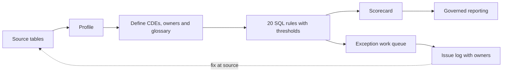

# Banking Data Governance & Data-Quality Framework

A working data governance framework for a synthetic retail and commercial bank: critical data elements with owners, a business glossary, **20 automated SQL data-quality rules**, a scorecard, an owned issue log, lineage, and a mapping to **BCBS 239** and the **Nigeria Data Protection Act 2023**.

> **Note:** This project uses the synthetic banking dataset from my [Banking Data Quality & Portfolio Performance case study](https://adefolakemibalogun.github.io/fola-balogun-analytics-portfolio/banking-operations.html). No real customer data is used. It mirrors the approach I use professionally, but it isn't employer work.

**Author:** Adefolake (Fola) Balogun, Certified Data Management Professional (CDMP), DAMA International · [Portfolio](https://adefolakemibalogun.github.io/fola-balogun-analytics-portfolio/) · [LinkedIn](https://www.linkedin.com/in/adefolake-balogun)

---

## The business problem

Management wants to rely on customer, account, transaction and loan figures for decisions and risk reporting. The figures can only be trusted if:

- everyone uses the **same definitions** (what counts as a closed account, or an overdue loan?)
- each critical data element has an **accountable owner**
- data quality is **measured routinely**, not checked once
- failures become **owned issues** that are fixed at source

## What this framework delivers

| Component | File | Purpose |
|---|---|---|
| Critical data element register | [`docs/cde_register.csv`](docs/cde_register.csv) | 17 CDEs, each with a definition, why it's critical, owner, steward, quality dimensions and linked rules |
| Business glossary | [`docs/business_glossary.md`](docs/business_glossary.md) | Agreed definitions, e.g. *overdue* vs *default*, and the governed reporting window |
| Data-quality rules | [`sql/02_dq_rules.sql`](sql/02_dq_rules.sql), [`docs/dq_rules.csv`](docs/dq_rules.csv) | 20 rules across 7 quality dimensions, each with a threshold, severity and owner |
| Profiling | [`sql/01_profiling.sql`](sql/01_profiling.sql) | Understand the data before writing rules, and reconcile to the published totals |
| Scorecard | [`results/dq_scorecard.csv`](results/dq_scorecard.csv) | Pass rate per rule against its threshold |
| Exception work queue | [`sql/03_exception_extracts.sql`](sql/03_exception_extracts.sql), [`results/exceptions.csv`](results/exceptions.csv) | Record-level failures for stewards to fix |
| Issue log | [`docs/issue_log.md`](docs/issue_log.md) | 10 issues and 1 monitored item, with impact, likely cause, owner and remediation |
| Lineage | [`docs/lineage.md`](docs/lineage.md) | Source-to-report flow, controls per reported figure, and reconciliation |
| Regulatory mapping | [`docs/regulatory_mapping.md`](docs/regulatory_mapping.md) | How the controls support BCBS 239 and NDPA 2023 principles |

## Results

**20 rules: 8 pass, 11 fail, 1 monitored.** Uniqueness and referential integrity are fully controlled. The main weaknesses are **stale loan status**, **closed accounts still holding balances** and **missing dates**.

### Key findings

1. **All 74 closed accounts still hold a balance (£4.29M)**: a closure-process gap and a conduct risk (ISS-01).
2. **48 "Active" loans (£2.44M) are past maturity** at the 31 December 2023 reporting date, so overdue exposure may be understated (ISS-02).
3. **9 Active loans sit on closed accounts**, meaning live credit is attached to an account that can't receive repayments (ISS-03).
4. **990 transactions (£2.47M) have no date**, so they can't be assigned to any reporting period (ISS-04).
5. **Every loan links to a real account and its correct owner**: a control that's working and should be protected.

### Scorecard by dimension

| Dimension | Rules | Passed | Records tested | Records failed | Pass rate |
|---|---|---|---|---|---|
| Completeness | 3 | 0 | 51,481 | 1,029 | 98.00% |
| Conformity | 1 | 0 | 330 | 330 | 0.00% |
| Consistency | 6 | 3 | 50,600 | 101 | 99.80% |
| Referential integrity | 1 | 1 | 330 | 0 | 100.00% |
| Timeliness | 2 | 0 | 48,749 | 1,768 | 96.37% |
| Uniqueness | 2 | 2 | 51,151 | 0 | 100.00% |
| Validity | 4 | 2 | 51,805 | 11 | 99.98% |

### Scorecard by rule

| Rule | Dimension | Check | Tested | Failed | Pass rate | Threshold | Status |
|---|---|---|---|---|---|---|---|
| DQ01 | Uniqueness | transaction_id is unique | 49,500 | 0 | 100.00% | 100% | ✅ Pass |
| DQ02 | Completeness | transaction_date is populated | 49,500 | 990 | 98.00% | 99.5% | ❌ Fail |
| DQ03 | Validity | amount is greater than zero | 49,500 | 0 | 100.00% | 100% | ✅ Pass |
| DQ04 | Timeliness | dated transactions fall inside the governed 2020-2023 reporting window | 48,510 | 1,720 | 96.45% | 99.5% | ❌ Fail |
| DQ05 | Consistency | derived year and month agree with transaction_date | 48,510 | 0 | 100.00% | 100% | ✅ Pass |
| DQ06 | Uniqueness | account_id appears once in the account master | 1,651 | 0 | 100.00% | 100% | ✅ Pass |
| DQ07 | Completeness | every account has an opening_date | 1,651 | 33 | 98.00% | 99.5% | ❌ Fail |
| DQ08 | Validity | account_balance is not negative | 1,651 | 10 | 99.39% | 99.5% | ❌ Fail |
| DQ09 | Consistency | closed accounts carry a zero balance | 74 | 74 | 0.00% | 100% | ❌ Fail |
| DQ10 | Completeness | every customer holds at least one account (monitored) | 1,100 | 238 | 78.36% | n/a | 👁 Monitor |
| DQ11 | Consistency | each customer has a single customer_type | 1,100 | 0 | 100.00% | 100% | ✅ Pass |
| DQ12 | Referential integrity | every loan links to an account in the account master | 330 | 0 | 100.00% | 100% | ✅ Pass |
| DQ13 | Consistency | loan customer matches the account owner | 330 | 0 | 100.00% | 100% | ✅ Pass |
| DQ14 | Completeness | loan start_date is populated | 330 | 6 | 98.18% | 100% | ❌ Fail |
| DQ15 | Validity | estimated_end_date is after start_date | 324 | 1 | 99.69% | 100% | ❌ Fail |
| DQ16 | Consistency | loan starts on or after the account opening date | 313 | 18 | 94.25% | 100% | ❌ Fail |
| DQ17 | Consistency | no active or overdue loans sit on closed accounts | 273 | 9 | 96.70% | 100% | ❌ Fail |
| DQ18 | Timeliness | active loans are not past their estimated end date at 2023-12-31 | 239 | 48 | 79.92% | 99% | ❌ Fail |
| DQ19 | Conformity | loan identifiers use the same numeric type as the account master | 330 | 330 | 0.00% | 100% | ❌ Fail |
| DQ20 | Validity | interest_rate is within the approved 1%-25% range | 330 | 0 | 100.00% | 100% | ✅ Pass |

## How it works



1. **Profile** the data to understand volumes, domains, ranges and types.
2. **Define** critical data elements, owners, stewards and agreed business definitions.
3. **Write rules** for each CDE, covering completeness, uniqueness, validity, consistency, timeliness, referential integrity and conformity, each with a threshold and severity.
4. **Measure** every rule and publish a scorecard.
5. **Route exceptions** to the accountable owner as issues with a remediation action.
6. **Reconcile** governed totals back to the published reporting.

## Run it yourself

```bash
pip install -r requirements.txt
# Download banking-operations-mi.xlsx from the portfolio repository's Files folder
python scripts/load_data.py path/to/banking-operations-mi.xlsx   # builds data/bank.db
python scripts/run_checks.py          # writes results/dq_scorecard.csv
python scripts/extract_exceptions.py  # writes results/exceptions.csv (add --all for every record)
```

Source workbook: [`Files/banking-operations-mi.xlsx`](https://github.com/adefolakemibalogun/fola-balogun-analytics-portfolio/blob/main/Files/banking-operations-mi.xlsx) in the portfolio repository.

## Repository structure

```text
banking-data-governance-framework/
├── README.md
├── requirements.txt
├── docs/
│   ├── cde_register.csv
│   ├── business_glossary.md
│   ├── dq_rules.csv
│   ├── issue_log.md
│   ├── lineage.md
│   └── regulatory_mapping.md
├── sql/
│   ├── 01_profiling.sql
│   ├── 02_dq_rules.sql
│   └── 03_exception_extracts.sql
├── scripts/
│   ├── load_data.py
│   ├── run_checks.py
│   └── extract_exceptions.py
└── results/
    ├── dq_scorecard.csv
    ├── dq_dimension_summary.csv
    └── exceptions.csv
```

## Tools

SQL (SQLite, portable to MySQL) · Python · DAMA-DMBOK data-quality dimensions · BCBS 239 · NDPA 2023. In professional work I apply the same approach with Collibra, Informatica Data Quality (IDQ) and Microsoft Purview.
