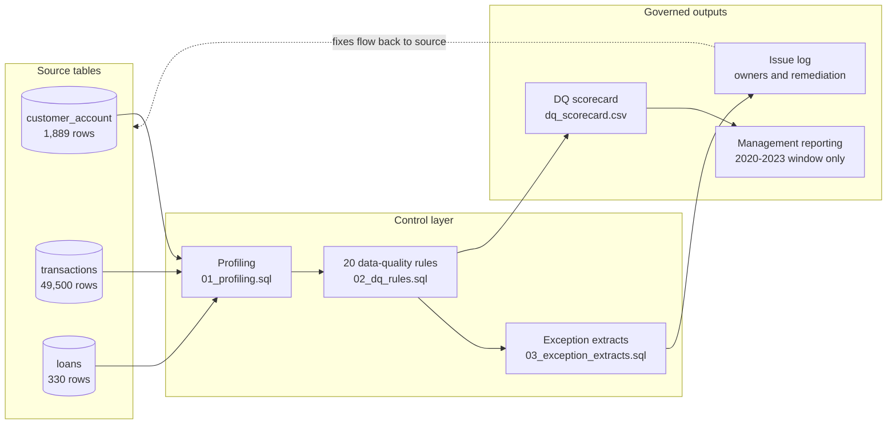

# Data Lineage

How data moves from source tables to the figures management sees, and where each control sits.

## Lineage by critical data element

| Reported figure | Source element | Transformation | Controls applied |
|---|---|---|---|
| Total customers | `customer_account.customer_id` | Distinct count, customers without accounts kept | DQ10, DQ11 |
| Total account balance | `customer_account.account_balance` | Sum at account grain (never through joins) | DQ06, DQ08, DQ09 |
| Transaction value (2020–2023) | `transactions.amount`, `transaction_date` | Sum of dated transactions inside the governed window | DQ01, DQ02, DQ03, DQ04, DQ05 |
| Loan portfolio | `loans.principal_amount` | Sum of principal across all loans | DQ12, DQ13, DQ20 |
| Overdue exposure | `loans.principal_amount`, `loan_status` | Sum of principal where status = Overdue | DQ17, DQ18 |

## Reconciliation to the published case study

The governed layer ties back to the figures in the [Banking Data Quality & Portfolio Performance case study](https://adefolakemibalogun.github.io/fola-balogun-analytics-portfolio/banking-operations.html):

| Measure | Governed layer | Case study |
|---|---|---|
| Customers | 1,100 | 1,100 |
| Accounts | 1,651 | 1,651 |
| Total account balance | £81,036,977.59 | £81.04M |
| Loan portfolio | £17,087,413.80 | £17.09M |
